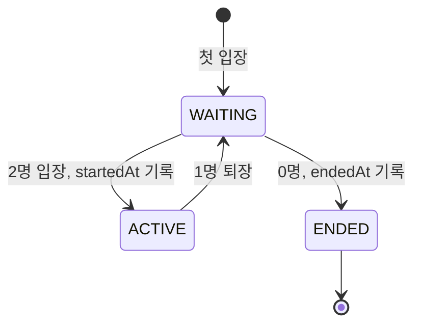
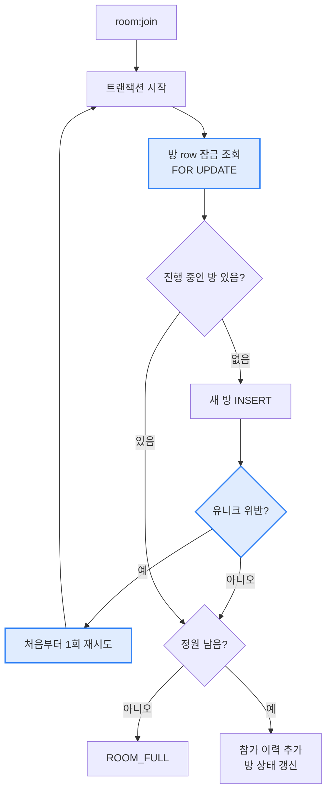

# 1:1 화상통화 시그널링 서버 만들기

> NestJS로 1:1 화상통화의 시그널링 서버를 만들고, 모바일 웹 클라이언트로 두 단말 연결까지 검증한 과정을 정리합니다.

`feat/video-call-signaling` · `2026-10-23` · `Feature`

## 들어가며

화상통화라고 하면 서버가 영상을 받아서 상대에게 넘겨주는 모습을 떠올리기 쉽습니다. 하지만 1:1 통화에서는 영상과 음성이 서버를 거치지 않습니다. 두 단말이 WebRTC로 직접 연결해서 주고받습니다.

그럼 서버는 무엇을 할까요? 두 단말이 서로를 찾고 연결 조건을 맞추려면, 처음에는 누군가 메시지를 전달해 줘야 합니다. 이 과정을 시그널링이라고 합니다. 이번에 만든 Nest 서버는 시그널링만 맡습니다. 방에 누가 들어왔는지 관리하고, 연결 정보(SDP)와 네트워크 경로 후보(ICE candidate)를 상대에게 그대로 넘겨줍니다.

목표는 모바일과 모바일(태블릿 포함) 사이의 1:1 통화였습니다. 시작하면서 가장 먼저 나온 질문은 "프론트가 웹일 때와 앱일 때 화면이 달라지는가"였습니다.

## 문제 상황 1: 웹과 앱에 따라 서버도 달라져야 할까요

결론부터 말하면 서버는 같습니다. SDP와 ICE candidate는 표준 형식이라서 웹이든 앱이든 같은 이벤트로 주고받으면 됩니다. 웹 단말과 앱 단말끼리 통화하는 것도 같은 서버로 됩니다.

달라지는 건 클라이언트입니다. 영상을 화면에 그리는 방법, 권한을 받는 방법, 백그라운드에서의 동작이 다릅니다.

| 항목 | 모바일 웹 (Safari, Chrome) | 앱 (React Native, Flutter) |
|---|---|---|
| 영상 출력 | `<video>` 태그에 스트림 연결 | `RTCView`, `RTCVideoView` 같은 네이티브 뷰 |
| iOS 자동재생 | `playsinline`, `muted`가 없으면 막히거나 전체화면이 강제됨 | 해당 없음 |
| HTTPS | 필수. `localhost` 외에는 카메라 접근 불가 | 필요 없음 |
| 권한 | 브라우저 팝업 | `Info.plist`, `AndroidManifest`에 선언 |
| 백그라운드 | 탭이 뒤로 가면 카메라가 멈춤 | 백그라운드 모드로 유지 가능 |
| 수신 화면 | 페이지가 열려 있을 때만 | CallKit, ConnectionService로 잠금화면 수신 |

특히 모바일 웹은 HTTPS가 아니면 카메라를 쓸 수 없습니다. 같은 Wi-Fi에 있는 폰에서 `http://192.168.x.x`로 열면 권한 요청부터 막힙니다. 그래서 서버는 클라이언트 종류와 무관하게 만들고, 검증은 빌드 없이 바로 열 수 있는 모바일 웹 페이지로 하기로 했습니다.

## 문제 상황 2: 방 상태를 DB에 두면 정합성이 깨질 수 있습니다

처음 플랜은 방 상태를 서버 메모리에 두는 것이었습니다. 이후 통화방과 참가 이력을 PostgreSQL에 남기기로 방향을 바꿨는데요, 상태를 DB에 두면 두 가지 문제가 생깁니다.

첫째는 동시 입장입니다. 정원이 2명인 방에 두 사람이 거의 동시에 들어오면, 둘 다 "아직 1명이니 들어올 수 있다"고 판단해서 3명이 될 수 있습니다. 방이 아직 없을 때는 더 까다롭습니다. 둘 다 방을 찾지 못하고 각자 새 방을 만들려고 하기 때문입니다.

둘째는 서버 재시작입니다. 참가 이력에는 socket.io 연결 ID를 저장하는데, 서버가 재시작되면 모든 연결이 끊기고 이 ID도 쓸모가 없어집니다. 그런데 DB에는 여전히 "접속 중"으로 남아 있습니다. 아무도 없는데 ACTIVE 상태인 방이 생기는 거죠.

## 고민한 방법들

실시간 통신에는 socket.io를 골랐습니다. 순수 WebSocket(ws)이 더 가볍지만, 방 관리와 재연결을 직접 만들어야 합니다. socket.io는 둘 다 기본으로 있고 React Native, Flutter용 클라이언트도 있습니다.

연결 구조는 P2P로 했습니다. 다자간 통화라면 미디어 서버(SFU)가 필요하지만, 1:1에서는 P2P가 서버 부하와 지연이 가장 적습니다.

DB에는 방과 참가 이력만 저장합니다. SDP와 ICE candidate는 연결할 때 잠깐 쓰고 버리는 데이터라서, 저장하면 지연과 부하만 늘어납니다. 서버는 받는 즉시 상대에게 넘겨주기만 합니다.

정원은 방 row에 비관적 락(`SELECT … FOR UPDATE`)을 걸어서 지키기로 했습니다. 유니크 제약을 응용하는 방법도 있지만 락이 의도가 가장 분명하고, 1:1 규모에서는 락 비용도 무시할 만합니다. 스키마는 TypeORM의 `synchronize` 대신 마이그레이션으로 관리합니다. 컬럼 comment까지 DB에 남기려면 마이그레이션이 필요했습니다.

| 방법 | 장점 | 아쉬운 점 | 결정 |
|---|---|---|---|
| 순수 WebSocket (ws) | 가벼움 | 방·재연결 직접 구현 | 패스 |
| socket.io | 방·재연결 내장, RN·Flutter 클라이언트 있음 | 프로토콜이 무거운 편 | ✅ 채택 |
| SFU (미디어 서버) | 다자간 확장 가능 | 1:1에는 과한 구성 | 패스 |
| P2P | 서버 부하·지연 최소 | 다자간으로 늘리면 바꿔야 함 | ✅ 채택 |
| 방 상태를 메모리에 저장 | 단순함 | 통화 기록이 남지 않음 | 패스 (처음 플랜) |
| 방·참가 이력을 DB에 저장 | 통화 기록, 정원 판단 근거가 DB에 있음 | 동시성·재시작 정리가 필요 | ✅ 채택 |
| SDP·ICE까지 DB에 저장 | 이력 추적 | 지연·부하만 늘어남 | 패스 |
| 정원 판단: 유니크 제약 응용 | 락 없음 | 의도가 잘 안 보임 | 패스 |
| 정원 판단: 비관적 락 | 의도가 분명함 | 방 생성 경합은 못 막음 → 재시도로 보완 | ✅ 채택 |
| `synchronize: true` | 설정이 편함 | 스키마 유실 위험, comment 관리 불가 | 패스 |
| 마이그레이션 | 변경 이력·comment 관리 | 파일 관리 필요 | ✅ 채택 |

## 해결 방법 1: 게이트웨이는 중계만 하고, 판단은 서비스에 모았습니다

시그널링 흐름을 그려보면 아래와 같습니다.


파란 구간이 서버가 하는 일의 대부분입니다. 받은 메시지에 보낸 사람(`fromId`)만 붙여서 같은 방 상대에게 넘깁니다. offer는 `room:peer-joined`를 받은 쪽, 즉 먼저 들어와 있던 쪽이 만듭니다. 그래서 상대가 나갔다가 다시 들어와도 남아 있던 쪽이 자연스럽게 다시 연결을 시작합니다.

역할은 계층별로 나눴습니다. `CallGateway`는 이벤트를 받아 서비스를 호출하고 결과를 보내기만 합니다. 입장할 수 있는지, 누구에게 중계할지는 `CallService`가 정합니다. 서비스는 `Socket` 객체 대신 연결 ID 문자열만 받기 때문에 WebSocket 없이도 테스트할 수 있습니다.

에러도 한 가지 형태로 맞췄습니다. 서비스는 전송 방식과 무관한 `CallException`을 던지고, 게이트웨이의 예외 필터가 이것을 `exception` 이벤트로 바꿉니다. 요청 데이터 검증에 실패한 경우도 같은 형태로 보냅니다.

```ts
// 클라이언트가 받는 exception 이벤트
{ status: 'error', code: 'ROOM_FULL', message: '방(room-1)의 정원이 가득 찼습니다.', event: 'room:join' }
// code: ROOM_FULL / NOT_IN_ROOM / PEER_NOT_FOUND / INVALID_PAYLOAD
```

## 해결 방법 2: 방 상태는 Entity 메서드로만 바꿉니다

통화방은 세 가지 상태를 가집니다. 상태가 바뀌는 흐름을 그려보면 아래와 같습니다.



1명이 나가면 ENDED가 아니라 WAITING으로 돌아갑니다. 남은 사람에게 상대가 다시 들어올 수 있게 하기 위해서입니다. `startedAt`은 처음 2명이 된 시각을 유지합니다.

상태 전이는 `CallRoom`의 `canAccept`, `markJoined`, `markLeft` 메서드에서만 일어납니다. 서비스는 현재 인원을 넘겨주기만 하고, 정원 상수와 판단 로직은 Entity 안에 있습니다.

```ts
// CallRoom: 퇴장 반영 후 인원으로 상태 갱신
markLeft(activeCount: number): void {
  if (this.isEnded()) return;
  if (activeCount === 0) { this.status = CallRoomStatus.ENDED; this.endedAt = new Date(); return; }
  if (activeCount < this.maxParticipants) this.status = CallRoomStatus.WAITING;
}
```

끝난 방의 코드는 다시 쓸 수 있습니다. `room_code` 유니크 인덱스를 `WHERE status <> 'ENDED'` 조건으로 걸어서, 진행 중인 방끼리만 코드가 겹치지 않게 했습니다.

## 해결 방법 3: 락과 재시도로 정원을 지키고, 기동할 때 남은 상태를 정리합니다

### 동시 입장

입장 흐름을 그려보면 아래와 같습니다.



방이 이미 있으면 락이 순서를 정해 줍니다. 먼저 락을 잡은 쪽이 들어가고, 다음 쪽은 갱신된 인원을 보고 판단합니다.

방이 아직 없을 때는 잠글 row가 없어서 락으로 막을 수 없습니다. 이때는 두 번째 INSERT가 부분 유니크 인덱스에 걸려 실패(23505)합니다. 그래서 유니크 위반이 나면 한 번만 처음부터 다시 시도합니다. 다시 시도할 때는 먼저 만들어진 방을 찾아서 락을 잡게 됩니다.

```ts
async join(socketId: string, dto: ReqJoinRoomDto): Promise<ResRoomJoinedDto> {
  try {
    return await this.joinOnce(socketId, dto);   // 트랜잭션 + FOR UPDATE
  } catch (error) {
    if (!this.isUniqueViolation(error)) throw error;
    return this.joinOnce(socketId, dto);         // 동시 방 생성 → 1회 재시도
  }
}
```

새 방에 3명이 동시에 입장하는 경우를 실제 DB로 돌려보니 2명은 성공하고 1명은 `ROOM_FULL`을 받았습니다. 진행 중인 방은 1개, 접속 중인 참가자는 2명으로 정원을 넘지 않았습니다.

### 서버 재시작 정리

서버가 뜰 때 `onApplicationBootstrap`에서 접속 중으로 남은 참가 이력을 퇴장 처리하고, 진행 중으로 남은 방을 종료합니다.

처음 플랜에서는 참가 이력을 UPDATE 한 번으로 일괄 처리하려고 했습니다. 하지만 그러면 상태가 Entity 메서드를 거치지 않고 바뀝니다. 그래서 남은 데이터를 조회한 뒤 Entity 메서드로 바꾸고 한 번에 저장하는 방식으로 바꿨습니다. 방도 함께 정리하지 않으면 0명인데 ACTIVE인 방이 남기 때문에 같이 처리합니다.

```ts
async onApplicationBootstrap(): Promise<void> {
  await this.dataSource.transaction(async (manager) => {
    const participants = await this.callParticipantRepository.findAllActive(manager);
    participants.forEach((participant) => participant.leave());
    ...
    const rooms = await this.callRoomRepository.findAllOpen(manager);
    rooms.forEach((room) => room.markLeft(0));
    ...
  });
}
```

이 정리는 서버가 1대라는 전제에서만 맞습니다. 서버가 여러 대가 되면 다른 서버에 붙어 있는 접속자까지 퇴장시키게 됩니다.

## 해결 방법 4: 모바일 웹 클라이언트로 두 단말 연결을 검증했습니다

검증용 클라이언트는 `public/index.html` 한 파일입니다. Nest가 `/client/` 경로로 서빙하고, socket.io 클라이언트 스크립트도 서버가 제공하는 `/socket.io/socket.io.js`를 쓰기 때문에 빌드나 CDN이 필요 없습니다.

화면은 휴대폰 세로일 때 상대 영상을 전체 화면으로 띄우고 내 영상을 작은 창(PiP)으로 겹칩니다. 태블릿 가로일 때는 미디어쿼리로 좌우 분할합니다. iOS를 위해 `<video>`에 `playsinline`을 붙이고 내 영상은 `muted`로 두었습니다. 카메라 전환은 연결을 끊지 않고 송신 트랙만 `replaceTrack`으로 바꿉니다.

검증하다가 버그를 하나 찾았습니다. 자동재생이 막힌 것도 아닌데 "화면을 눌러 상대 소리 재생" 안내가 떴습니다. `ontrack`은 오디오와 비디오 트랙마다 한 번씩 호출되는데, 그때마다 같은 스트림을 다시 넣어서 첫 번째 `play()`가 중단(AbortError)된 것이었습니다.

```js
// Before: 트랙마다 다시 넣음 → 첫 play()가 AbortError → 안내가 잘못 뜸
ui.remote.srcObject = stream;
ui.remote.play().catch(() => ui.tapToPlay.classList.add('on'));

// After: 같은 스트림이면 건너뛰고, 자동재생 차단일 때만 안내
if (ui.remote.srcObject === stream) return;
ui.remote.srcObject = stream;
ui.remote.play().catch((e) => {
  if (e.name === 'NotAllowedError') ui.tapToPlay.classList.add('on');
});
```

검증은 headless Chrome에 가짜 카메라를 연결해서 탭 두 개로 했습니다. 양쪽 모두 P2P 상태가 `connected`가 되고 상대 영상을 받았습니다. 3번째 탭은 `ROOM_FULL`을 받았고, 한쪽이 나갔다가 다시 들어오면 재연결됐습니다.

## 결과

- 같은 방 코드로 들어온 두 단말이 서버를 통해 offer, answer, ICE를 주고받고 P2P로 연결됩니다. 웹과 앱 모두 같은 이벤트 규약으로 붙일 수 있습니다.
- 동시에 입장해도 정원 2명을 넘지 않고, 서버를 재시작하면 남은 접속 상태가 자동으로 정리됩니다.
- 정원 초과, 방 미입장, 상대 없음, 잘못된 요청을 모두 같은 형태의 `exception` 이벤트로 받을 수 있습니다.
- 테스트 26개(Entity, Service, Gateway 통합)가 통과합니다. 실기기 HTTPS 테스트와 배포는 아직 하지 않았습니다.

## 마치며

1:1 화상통화에서 서버가 맡는 일은 생각보다 작습니다. 영상은 단말끼리 주고받고, 서버는 처음 연결을 이어 주는 역할만 합니다. 대신 그 작은 역할에서도 방 상태를 DB에 두는 순간 동시성과 재시작 정리를 신경 써야 했습니다.

다음으로 몇 가지가 남아 있습니다. 모바일 데이터(통신사 NAT)에서는 STUN만으로 연결이 실패하는 경우가 많아서 TURN 서버가 필요합니다. 지금은 TURN 계정을 환경 변수로 받아 그대로 내려주는데, 운영에서는 시간 제한이 있는 임시 자격증명으로 바꿔야 합니다. 서버를 여러 대로 늘리려면 socket.io Redis adapter와 재시작 정리 조건 변경이 필요합니다. 서버 종료 중에 DB 연결이 먼저 닫혀 연결 끊김 처리가 실패하는 순서 문제도 정리해야 합니다.

패키지 버전도 주의해야 합니다. Nest 12 계열의 `@nestjs/websockets`, `@nestjs/platform-socket.io`, `@nestjs/serve-static`은 core 12가 필요합니다. `@nestjs/config`, `@nestjs/typeorm` 12는 ESM 전용이라 Jest에서 불러오지 못합니다. 그래서 지금은 모두 Nest 11 라인으로 고정해 두었고, Nest 12로 올릴 때 함께 정리해야 합니다.

---

## 부록: 실행·테스트 가이드

### 1. 실행

```bash
cp .env.example .env            # DB: localhost:5434 / video-chat-local
yarn install
yarn migration:run              # call_room, call_participant 생성
yarn start:dev
```

* DB(`video-chat-local`, 테스트용 `video-chat-test`)는 `jm-postgres` 컨테이너에 미리 만들어 둔다.
* 테스트: `yarn test` (게이트웨이 통합 테스트는 `video-chat-test` DB 사용)

### 2. PC 브라우저 두 탭

1. `http://localhost:3000/client/` 를 탭 두 개로 연다.
2. 같은 방 코드(예: `room-1`)로 각각 입장한다.
3. 상태가 `통화 중` 이 되면 성공. `call_room` 상태가 `ACTIVE` 로 바뀐다.

* `localhost` 는 HTTPS가 아니어도 카메라를 쓸 수 있다.
* 링크 공유: `http://localhost:3000/client/?room=room-1` 처럼 `room` 파라미터로 방 코드를 채울 수 있다.

### 3. 휴대폰·태블릿 실기기 (HTTPS 필수)

모바일 브라우저는 **HTTPS가 아니면 카메라·마이크 접근이 막힌다** (`http://192.168.x.x` 불가).

```bash
# 터널 중 하나로 HTTPS 주소를 만든다 (WebSocket 지원)
ngrok http 3000
# 또는
cloudflared tunnel --url http://localhost:3000
```

1. 출력된 `https://…` 주소 뒤에 `/client/` 를 붙여 두 기기에서 연다.
2. 같은 방 코드로 입장 → 카메라·마이크 권한 허용.
3. iOS에서 상대 소리가 안 나오면 화면의 "화면을 눌러 상대 소리 재생" 안내를 탭한다 (자동재생 정책).

| 증상 | 원인 / 조치 |
|---|---|
| 입장 시 "HTTPS(또는 localhost)에서만…" | HTTP 주소로 접속함 → 터널 HTTPS 주소 사용 |
| 같은 Wi-Fi에선 되는데 LTE/5G에선 `연결 실패` | 통신사 NAT로 STUN만으론 P2P 불가 → **TURN 서버** 필요. `.env` 에 `TURN_URL/TURN_USERNAME/TURN_CREDENTIAL` 설정 (coturn 등) |
| 화면이 꺼지거나 앱 전환 시 끊김 | 모바일 웹 한계. 백그라운드 유지·잠금화면 수신은 네이티브 앱(CallKit 등) 영역 |

### 4. 이벤트 규약 (웹·앱 공통)

시작 전 `GET /call/ice-servers` 응답의 `iceServers` 를 `RTCPeerConnection` 설정에 그대로 넣는다.

| 방향 | 이벤트 | payload |
|---|---|---|
| C → S | `room:join` | `{ roomCode }` |
| S → C | `room:joined` | `{ roomId, roomCode, peerCount, isInitiator }` |
| S → 상대 | `room:peer-joined` | `{ roomCode, peerId }` — 받은 쪽이 **offer 생성** |
| C → S → 상대 | `signal:offer` / `signal:answer` | `{ roomCode, sdp: { type, sdp } }` → `+ fromId` |
| C → S → 상대 | `signal:ice` | `{ roomCode, candidate: RTCIceCandidateInit }` → `+ fromId` |
| C → S | `room:leave` | `{ roomCode }` |
| S → 상대 | `room:peer-left` | `{ roomCode, peerId }` |
| S → C | `exception` | `{ status: 'error', code, message, event? }` |

* `code`: `ROOM_FULL`(정원 2명 초과) / `NOT_IN_ROOM` / `PEER_NOT_FOUND` / `INVALID_PAYLOAD`
* `roomCode`: 영문·숫자·`_`·`-`, 최대 64자
* 연결이 끊기면 서버가 자동으로 퇴장 처리하고 상대에게 `room:peer-left` 를 보낸다.

### 5. 앱(React Native / Flutter)으로 붙일 때

서버는 그대로 쓰고 클라이언트만 바꾼다.

* WebRTC: `react-native-webrtc` / `flutter_webrtc` — API는 브라우저와 거의 같다.
* 소켓: `socket.io-client`(RN) / `socket_io_client`(Flutter), 위 이벤트 규약 동일.
* 화면: `<video>` 대신 `RTCView`(RN) / `RTCVideoView`(Flutter) 네이티브 뷰.
* 권한: iOS `Info.plist`(NSCameraUsageDescription, NSMicrophoneUsageDescription), Android `CAMERA`·`RECORD_AUDIO`.
* HTTPS 불필요, 백그라운드 통화·잠금화면 수신(CallKit/ConnectionService + VoIP Push) 가능. Expo Go 불가 → dev build.

---

<p align="center">
  <a href="http://nestjs.com/" target="blank"></a>
</p>

[circleci-image]: https://img.shields.io/circleci/build/github/nestjs/nest/master?token=abc123def456
[circleci-url]: https://circleci.com/gh/nestjs/nest

  <p align="center">A progressive <a href="http://nodejs.org" target="_blank">Node.js</a> framework for building efficient and scalable server-side applications.</p>
    <p align="center">
<a href="https://www.npmjs.com/~nestjscore" target="_blank"></a>
<a href="https://www.npmjs.com/~nestjscore" target="_blank"></a>
<a href="https://www.npmjs.com/~nestjscore" target="_blank"></a>
<a href="https://circleci.com/gh/nestjs/nest" target="_blank"></a>
<a href="https://discord.gg/G7Qnnhy" target="_blank"></a>
<a href="https://opencollective.com/nest#backer" target="_blank"></a>
<a href="https://opencollective.com/nest#sponsor" target="_blank"></a>
  <a href="https://paypal.me/kamilmysliwiec" target="_blank"></a>
    <a href="https://opencollective.com/nest#sponsor"  target="_blank"></a>
  <a href="https://twitter.com/nestframework" target="_blank"></a>
</p>
  <!--[](https://opencollective.com/nest#backer)
  [](https://opencollective.com/nest#sponsor)-->

## Description

[Nest](https://github.com/nestjs/nest) framework TypeScript starter repository.

## Project setup

```bash
$ yarn install
```

## Compile and run the project

```bash
# development
$ yarn run start

# watch mode
$ yarn run start:dev

# production mode
$ yarn run start:prod
```

## Run tests

```bash
# unit tests
$ yarn run test

# e2e tests
$ yarn run test:e2e

# test coverage
$ yarn run test:cov
```

## Deployment

When you're ready to deploy your NestJS application to production, there are some key steps you can take to ensure it runs as efficiently as possible. Check out the [deployment documentation](https://docs.nestjs.com/deployment) for more information.

If you are looking for a cloud-based platform to deploy your NestJS application, check out [Mau](https://mau.nestjs.com), our official platform for deploying NestJS applications on AWS. Mau makes deployment straightforward and fast, requiring just a few simple steps:

```bash
$ yarn install -g @nestjs/mau
$ mau deploy
```

With Mau, you can deploy your application in just a few clicks, allowing you to focus on building features rather than managing infrastructure.

## Resources

Check out a few resources that may come in handy when working with NestJS:

- Visit the [NestJS Documentation](https://docs.nestjs.com) to learn more about the framework.
- For questions and support, please visit our [Discord channel](https://discord.gg/G7Qnnhy).
- To dive deeper and get more hands-on experience, check out our official video [courses](https://courses.nestjs.com/).
- Deploy your application to AWS with the help of [NestJS Mau](https://mau.nestjs.com) in just a few clicks.
- Visualize your application graph and interact with the NestJS application in real-time using [NestJS Devtools](https://devtools.nestjs.com).
- Need help with your project (part-time to full-time)? Check out our official [enterprise support](https://enterprise.nestjs.com).
- To stay in the loop and get updates, follow us on [X](https://x.com/nestframework) and [LinkedIn](https://linkedin.com/company/nestjs).
- Looking for a job, or have a job to offer? Check out our official [Jobs board](https://jobs.nestjs.com).

## Support

Nest is an MIT-licensed open source project. It can grow thanks to the sponsors and support by the amazing backers. If you'd like to join them, please [read more here](https://docs.nestjs.com/support).

## Stay in touch

- Author - [Kamil Myśliwiec](https://twitter.com/kammysliwiec)
- Website - [https://nestjs.com](https://nestjs.com/)
- Twitter - [@nestframework](https://twitter.com/nestframework)

## License

Nest is [MIT licensed](https://github.com/nestjs/nest/blob/master/LICENSE).
