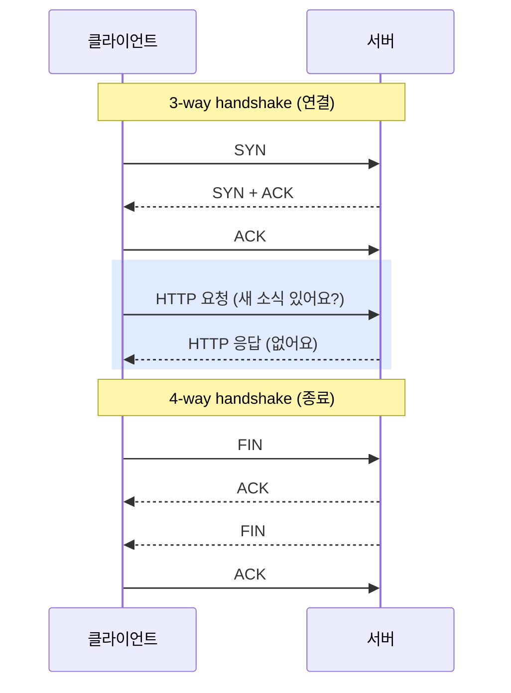
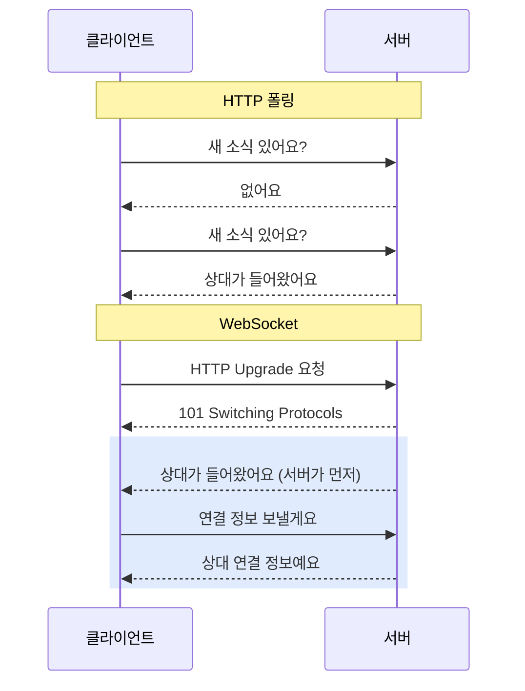
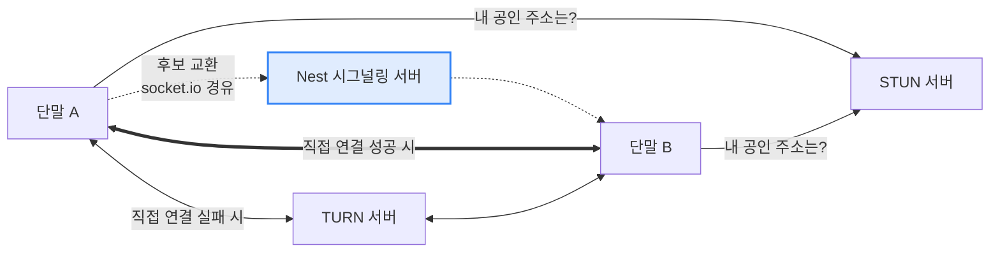
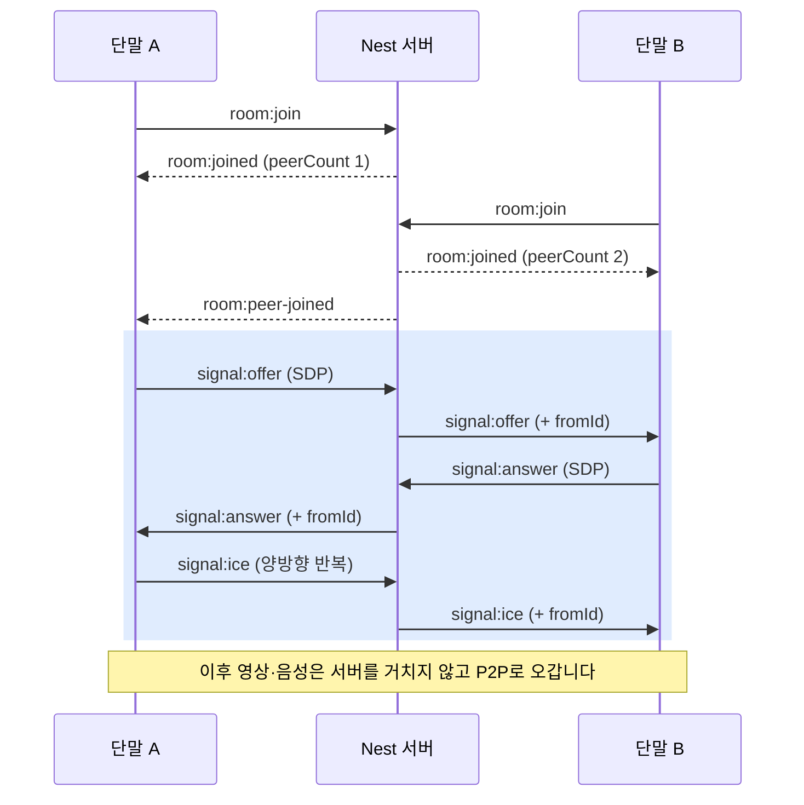
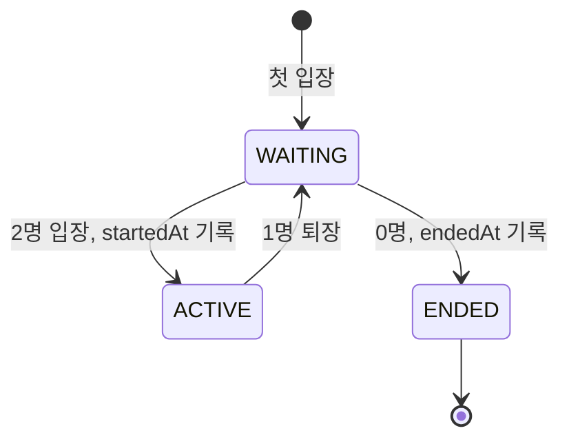

# socket.io로 1:1 화상통화 만들기

> 실시간 통신을 처음 접하는 사람도 따라올 수 있도록, socket.io와 WebRTC로 두 휴대폰을 영상으로 연결한 원리를 정리합니다.

`feat/video-call-signaling` · `2026-10-23` · `Feature`

## 들어가며

화상통화 앱을 켜면 상대 얼굴이 거의 바로 보입니다. 그런데 이 짧은 순간에 일어나는 일은 생각보다 많습니다. 두 휴대폰이 서로의 위치를 알아내고, 어떤 형식으로 영상을 주고받을지 맞추고, 그다음에야 영상이 흐르기 시작합니다.

이 글에서 만든 구성은 두 부분으로 나뉩니다. 영상과 음성은 **WebRTC**로 두 단말이 직접 주고받습니다. 그 직접 연결을 만들기 위해 필요한 사전 대화는 **socket.io**로 서버를 거쳐 주고받습니다. 이 사전 대화를 **시그널링(signaling)**이라고 부릅니다.

쉽게 비유하면 이렇습니다. 두 사람이 직접 만나려면 먼저 전화로 "어디서, 몇 시에 볼까?"를 정해야 합니다. 이 전화가 시그널링이고, 실제 만남이 WebRTC 연결입니다. NestJS 서버는 전화 교환원 역할만 하고, 만남 자리에는 끼지 않습니다.

아래에서는 왜 이런 구조가 필요한지부터 차례로 살펴봅니다. 구현 코드는 개념을 확인하는 정도로만 짧게 보여드립니다.

## 문제 상황 1: HTTP는 서버가 먼저 말을 걸 수 없습니다

웹의 기본 통신 방식인 HTTP는 **요청-응답** 구조입니다. 클라이언트가 물어봐야 서버가 대답합니다. 서버가 먼저 "상대가 방에 들어왔어요"라고 알려줄 방법이 없습니다.

화상통화는 이런 알림의 연속입니다. 상대가 들어왔다, 상대가 연결 정보를 보냈다, 상대가 나갔다. 모두 **내가 묻지 않았는데 서버가 알려줘야 하는** 이벤트입니다.

HTTP로 흉내 내는 방법이 없지는 않습니다. 1초마다 "새 소식 있어요?"라고 물어보는 **폴링(polling)**이 대표적입니다. 하지만 대부분의 요청은 "없어요"로 끝나서 낭비가 크고, 알림이 최대 1초 늦게 도착합니다. 연결을 맺는 동안 메시지를 수십 번 주고받아야 하는 시그널링에는 맞지 않습니다.

### 연결을 맺고 끊는 데도 비용이 듭니다

폴링이 왜 비싼지 보려면 HTTP 아래에 있는 **TCP**를 봐야 합니다. HTTP 메시지는 TCP 연결 위로 오가는데, TCP는 데이터를 보내기 전에 연결을 맺고, 다 쓰면 연결을 끊는 절차를 거칩니다.

연결을 맺을 때는 패킷 세 개를 주고받습니다. 이것을 **3-way handshake**라고 합니다.

1. 클라이언트가 "연결하고 싶어요"라는 `SYN`을 보냅니다.
2. 서버가 "좋아요, 저도 연결할게요"라는 `SYN+ACK`로 답합니다.
3. 클라이언트가 "확인했어요"라는 `ACK`를 보내면 연결이 열립니다.

연결을 끊을 때는 패킷 네 개를 주고받습니다. 이것을 **4-way handshake**라고 합니다. 양쪽이 각자 "나는 더 보낼 게 없다"를 따로 알리고 따로 확인받기 때문에 하나가 더 많습니다.

1. 먼저 끊는 쪽이 "저는 다 보냈어요"라는 `FIN`을 보냅니다.
2. 상대가 `ACK`로 확인합니다. 상대는 아직 남은 데이터를 더 보낼 수 있습니다.
3. 상대도 다 보내면 `FIN`을 보냅니다.
4. 먼저 끊은 쪽이 `ACK`로 확인하면 연결이 닫힙니다. 이 쪽은 늦게 도착하는 패킷에 대비해 잠시 `TIME_WAIT` 상태로 기다립니다.

한 번의 요청이 연결부터 종료까지 거치는 과정을 그려보면 아래와 같습니다.



실제로 필요한 건 파란 구간 두 줄인데, 그 앞뒤로 패킷 일곱 개가 붙습니다. 패킷마다 네트워크를 한 번 왕복하는 시간이 들고, 모바일 네트워크에서는 이 왕복이 특히 깁니다. HTTPS라면 그 위에 TLS 협상까지 더해집니다.

HTTP/1.1의 keep-alive로 연결을 재사용하면 이 비용을 줄일 수 있습니다. 그래도 요청마다 헤더를 다시 보내야 하고, 여전히 클라이언트가 물어봐야만 서버가 답할 수 있다는 한계는 그대로입니다. 그래서 **연결은 한 번만 맺고, 그 위로 양쪽이 아무 때나 말할 수 있는 방식**이 필요했습니다.

## 문제 상황 2: 두 휴대폰은 서로의 주소를 모릅니다

영상을 서버를 거치지 않고 직접 보내려면, 보내는 쪽이 받는 쪽의 네트워크 주소를 알아야 합니다. 그런데 휴대폰에는 보통 외부에서 바로 찾아올 수 있는 주소가 없습니다.

집 Wi-Fi에 연결된 폰의 주소는 `192.168.0.10` 같은 **사설 IP**입니다. 공유기 안에서만 통하는 주소라서 밖에서는 이 주소로 찾아올 수 없습니다. 공유기나 통신사 장비는 여러 기기를 하나의 공인 주소 뒤에 숨기는데, 이것을 **NAT(Network Address Translation)**라고 합니다. 아파트 동·호수 없이 아파트 주소만 아는 상황과 비슷합니다.

주소 말고도 맞춰야 할 것이 있습니다. A는 VP8 코덱만 지원하고 B는 H.264만 지원한다면 영상을 보내도 해석하지 못합니다. 그래서 연결하기 전에 "나는 이런 형식을 지원하고, 이런 주소로 연락이 닿을 수 있어"라는 정보를 서로 교환해야 합니다. 직접 연결이 아직 없으니, 이 교환은 **둘 다 접속할 수 있는 서버**를 거쳐야 합니다.

## 고민한 방법들

서버가 먼저 말을 걸 수 있는 통로부터 골라야 했습니다. 폴링은 앞에서 본 것처럼 낭비가 큽니다. 요청을 열어 두고 새 소식이 생기면 그때 응답하는 **롱 폴링**은 지연은 줄지만 메시지마다 HTTP 요청을 다시 맺습니다. **SSE(Server-Sent Events)**는 서버에서 클라이언트로 한 방향만 됩니다. 시그널링은 양쪽이 계속 주고받아야 해서 맞지 않았습니다.

**WebSocket**은 연결 하나를 열어 두고 양쪽이 언제든 메시지를 보낼 수 있습니다. 시그널링에 딱 맞는 성격입니다. 다만 순수 WebSocket에는 "방", "이벤트 이름", "끊기면 재연결" 같은 개념이 없어서 직접 만들어야 합니다. **socket.io**는 WebSocket 위에 이런 기능을 얹은 라이브러리입니다. React Native와 Flutter용 클라이언트도 있어서 나중에 앱으로 옮기기도 쉽습니다.

영상을 어디로 흘릴지도 정해야 했습니다. 서버가 영상을 받아서 상대에게 넘기는 **미디어 서버(SFU)** 방식은 3명 이상 통화에 필요하지만, 1:1에서는 서버 비용과 지연만 늘어납니다. 그래서 두 단말이 직접 주고받는 **P2P** 방식을 골랐습니다.

| 방법 | 장점 | 아쉬운 점 | 결정 |
|---|---|---|---|
| HTTP 폴링 | 구현이 단순함 | 빈 요청이 많고 알림이 늦음 | 패스 |
| 롱 폴링 | 폴링보다 빠름 | 메시지마다 요청을 다시 맺음 | 패스 |
| SSE | 서버 → 클라이언트 푸시 | 단방향 | 패스 |
| 순수 WebSocket | 가볍고 양방향 | 방·재연결을 직접 구현 | 패스 |
| socket.io | 양방향 + 방·이벤트·재연결 내장, 앱 클라이언트 있음 | 프로토콜이 조금 무거움 | ✅ 채택 |
| 미디어 서버(SFU) 경유 | 다자간 확장 | 1:1에는 과한 비용·지연 | 패스 |
| P2P (WebRTC 직접 연결) | 서버 부하·지연 최소 | 다자간으로 늘리면 바꿔야 함 | ✅ 채택 |

## 해결 방법 1: socket.io로 항상 열려 있는 통로를 만들었습니다

WebSocket은 처음에 HTTP 요청으로 시작합니다. 클라이언트가 "이 연결을 WebSocket으로 바꾸자(Upgrade)"고 요청하고, 서버가 승낙하면 그때부터 같은 연결이 양방향 통로가 됩니다. 이후로는 요청-응답이 아니라 양쪽이 아무 때나 메시지를 보냅니다.

두 방식의 차이를 그려보면 아래와 같습니다.



파란 구간부터는 연결 하나로 양쪽이 자유롭게 말합니다. 앞에서 본 3-way handshake는 처음 한 번만 하고, 4-way handshake는 통화를 마치고 연결을 닫을 때 한 번만 합니다. 메시지마다 연결을 새로 맺지 않으니 빠르고 가볍습니다.

socket.io는 이 통로 위에 세 가지를 더해 줍니다. 이번 구현은 이 셋에 기대고 있습니다.

* **이벤트:** 메시지에 `room:join`, `signal:offer` 같은 이름을 붙여 보냅니다. 서버는 이름별로 처리 함수를 나눕니다. Nest에서는 `@SubscribeMessage('room:join')`처럼 붙이면 됩니다.
* **방(room):** 소켓 여러 개를 하나의 이름으로 묶습니다. `client.join(roomCode)`로 넣고, `server.to(roomCode).emit(...)`으로 방 전체에 보냅니다. 소켓마다 자기 ID로 된 방이 자동으로 있어서, `server.to(socketId)`로 특정 상대 한 명에게만 보낼 수도 있습니다.
* **연결 감시:** 서버와 클라이언트가 주기적으로 ping/pong을 주고받아서, 앱이 종료되거나 네트워크가 끊기면 서버가 알아챕니다. 이때 `handleDisconnect`가 불리고, 남은 상대에게 `room:peer-left`를 보냅니다.

socket.io는 원래 HTTP 롱 폴링으로 먼저 연결한 뒤 WebSocket으로 올라갑니다. 이번 클라이언트는 `io({ transports: ['websocket'] })`로 처음부터 WebSocket만 쓰게 했습니다. 모바일 브라우저는 모두 WebSocket을 지원하고, 이렇게 하면 연결 단계가 하나 줄어듭니다.

## 해결 방법 2: WebRTC 연결에 필요한 정보는 SDP와 ICE 두 가지입니다

**WebRTC**는 브라우저와 앱에 들어 있는 실시간 통신 표준입니다. 카메라·마이크 캡처, 압축, 암호화, 전송까지 모두 단말 안에서 처리합니다. 그래서 WebRTC 연결은 서버가 아니라 **클라이언트가 만듭니다.** 서버 코드에는 `RTCPeerConnection`이 한 줄도 없습니다.

연결을 맺으려면 문제 상황 2에서 본 두 가지 정보를 교환해야 합니다.

### SDP: "나는 이런 형식으로 주고받을 수 있어"

**SDP(Session Description Protocol)**는 영상·음성 형식을 적은 텍스트입니다. 지원하는 코덱, 해상도, 오디오·비디오 트랙 구성, 암호화 키 정보 등이 들어갑니다.

교환은 **offer/answer** 순서로 합니다. 한쪽이 "이 형식들로 하자"는 offer를 보내면, 다른 쪽이 자기가 지원하는 것과 맞춰서 answer를 돌려줍니다. 둘이 합의한 형식으로 통화가 시작됩니다.

### ICE: "나한테는 이 길로 오면 돼"

**ICE(Interactive Connectivity Establishment)**는 두 단말 사이에 실제로 데이터가 지나갈 길을 찾는 방법입니다. 각 단말은 자기에게 닿을 수 있는 주소 후보를 모읍니다. 이 후보 하나하나를 **ICE candidate**라고 합니다.

후보는 세 종류입니다.

| 후보 | 어떻게 얻나 | 언제 쓰이나 |
|---|---|---|
| host | 단말 자신의 사설 IP | 같은 Wi-Fi 안 |
| srflx | **STUN** 서버에 "밖에서 보면 내 주소가 뭐야?"라고 물어서 얻은 공인 주소 | 대부분의 가정·사무실 네트워크 |
| relay | **TURN** 서버가 중간에서 대신 받아 전달해 주는 주소 | NAT가 엄격해 직접 연결이 안 될 때 (통신사 LTE/5G 등) |

후보를 서로 교환하면 WebRTC가 조합을 하나씩 시험해 보고 통하는 길을 고릅니다. 흐름을 그려보면 아래와 같습니다.



이번에 만든 것은 파란 노드뿐입니다. STUN은 Google 공개 서버를 쓰고, 서버는 `GET /call/ice-servers`로 STUN·TURN 주소 목록을 내려주기만 합니다. 같은 Wi-Fi나 일반 가정 네트워크에서는 STUN만으로 연결되지만, 모바일 데이터에서는 TURN 없이 실패하는 경우가 많습니다.

후보는 한 번에 다 모이지 않습니다. 찾는 대로 하나씩 상대에게 보내는데, 이것을 **Trickle ICE**라고 합니다. 그래서 상대의 SDP가 도착하기 전에 후보가 먼저 도착할 수도 있습니다. 클라이언트는 이런 후보를 큐에 모아 두었다가, SDP를 적용한 뒤에 한꺼번에 넣습니다.

## 해결 방법 3: socket.io가 SDP와 ICE를 상대에게 전달합니다

이제 두 기술을 합칩니다. socket.io 통로로 SDP와 ICE를 전달하고, 교환이 끝나면 WebRTC가 직접 연결을 맺습니다. 전체 흐름을 그려보면 아래와 같습니다.



서버가 하는 일은 파란 구간이 대부분입니다. 받은 SDP나 ICE의 내용은 들여다보지 않고, 보낸 사람(`fromId`)만 붙여서 같은 방 상대에게 넘깁니다. 내용을 해석하는 건 양쪽 단말의 WebRTC입니다. 덕분에 서버는 웹이든 앱이든 상관없이 같은 코드로 동작합니다.

누가 offer를 만들지도 정해야 합니다. 양쪽이 동시에 offer를 보내면 충돌하기 때문입니다. 이번에는 `room:peer-joined`를 받은 쪽, 즉 **먼저 들어와 있던 쪽**이 offer를 만들기로 했습니다. 상대가 나갔다가 다시 들어와도 남아 있던 쪽이 자연스럽게 연결을 다시 시작합니다.

게이트웨이 코드를 보면 서버가 정말 전달만 한다는 게 드러납니다.

```ts
@SubscribeMessage(CALL_EVENTS.OFFER)
offer(@ConnectedSocket() client: Socket, @MessageBody() dto: ReqRelaySdpDto) {
  return this.relaySdp(CALL_EVENTS.OFFER, client, dto);   // answer도 같은 함수 사용
}

private async relaySdp(event: CallSdpEvent, client: Socket, dto: ReqRelaySdpDto) {
  const targetId = await this.callService.resolveRelayTarget(client.id, dto.roomCode); // 같은 방 상대 찾기
  this.server.to(targetId).emit(event, ResRelaySdpDto.from(dto, client.id));            // fromId만 붙여 전달
}
```

SDP와 ICE는 연결할 때 잠깐 쓰고 버리는 데이터라서 DB에 저장하지 않습니다. 서버는 받는 즉시 넘겨주기만 합니다.

## 해결 방법 4: 방 상태는 DB에 두고, 동시 입장은 락으로 막았습니다

시그널링 서버가 기억해야 하는 건 "누가 어느 방에 있는가" 하나입니다. 이번에는 통화 기록을 남기기 위해 방과 참가 이력을 PostgreSQL에 저장했습니다. 통화방은 세 가지 상태를 가집니다.



1명이 나가면 ENDED가 아니라 WAITING으로 돌아갑니다. 남은 사람에게 상대가 다시 들어올 수 있게 하기 위해서입니다. 상태는 `CallRoom` Entity의 `canAccept`, `markJoined`, `markLeft` 메서드로만 바꿉니다.

상태를 DB에 두면 **경쟁 상태(race condition)**를 신경 써야 합니다. 정원 2명인 방에 1명이 있을 때 두 사람이 동시에 들어오면, 둘 다 "아직 1명"이라고 읽고 둘 다 들어와서 3명이 될 수 있습니다.

그래서 방을 조회할 때 **비관적 락**(`SELECT … FOR UPDATE`)을 겁니다. 먼저 락을 잡은 트랜잭션이 끝날 때까지 다른 트랜잭션은 같은 방을 읽지 못하고 기다립니다. 거절하는 게 아니라 줄을 세우는 겁니다. 차례가 온 쪽은 갱신된 인원을 보고 판단하므로, 세 번째 사람은 `ROOM_FULL`을 받습니다.

방이 아직 없을 때는 잠글 행이 없습니다. 이 경우는 `room_code`에 진행 중인 방끼리만 겹치지 않게 하는 부분 유니크 인덱스를 걸어 두고, 두 번째 INSERT가 유니크 위반으로 실패하면 한 번 다시 시도합니다. 새 방에 3명이 동시에 입장하는 경우를 실제 DB로 돌려보니 2명은 입장하고 1명은 `ROOM_FULL`을 받았습니다.

마지막으로 서버 재시작입니다. 참가 이력에는 socket.io 연결 ID를 저장하는데, 서버가 재시작되면 모든 연결이 끊기고 이 ID는 의미가 없어집니다. 그래서 서버가 뜰 때(`onApplicationBootstrap`) 접속 중으로 남은 참가 이력과 진행 중인 방을 정리합니다. 이 방식은 서버가 1대라는 전제에서만 맞습니다.

## 결과

- 같은 방 코드로 들어온 두 단말이 socket.io로 SDP와 ICE를 교환하고, WebRTC로 직접 연결됩니다. 서버는 영상 데이터를 다루지 않습니다.
- 서버는 메시지 내용을 해석하지 않고 전달만 하므로, 웹과 앱 모두 같은 이벤트 규약으로 붙일 수 있습니다.
- 동시에 입장해도 정원 2명을 넘지 않고, 연결이 끊기거나 서버가 재시작되면 방 상태가 자동으로 정리됩니다.
- 테스트 26개(Entity, Service, Gateway 통합)가 통과하고, headless Chrome 두 탭에서 P2P `connected`와 상대 영상 수신을 확인했습니다. 실기기 HTTPS 테스트와 배포는 아직 하지 않았습니다.

## 마치며

화상통화에서 서버가 맡는 일은 생각보다 작습니다. 영상은 단말끼리 주고받고, 서버는 처음에 서로를 소개해 주는 역할만 합니다. socket.io는 그 소개를 위한 양방향 통로를 만들어 주고, WebRTC는 소개받은 정보로 직접 연결을 맺습니다. 이 두 역할을 나눠서 보면 구조가 훨씬 단순해집니다.

다음으로 몇 가지가 남아 있습니다. 모바일 데이터에서도 연결되려면 TURN 서버가 필요하고, 운영에서는 시간 제한이 있는 임시 자격증명을 써야 합니다. 서버를 여러 대로 늘리면 서로 다른 서버에 붙은 소켓끼리 메시지를 전달할 수 없으니 socket.io Redis adapter가 필요하고, 재시작 정리 조건도 바꿔야 합니다. 3명 이상 통화로 넓히려면 P2P 대신 SFU 구조를 검토해야 합니다.

패키지 버전도 주의해야 합니다. Nest 12 계열의 `@nestjs/websockets`, `@nestjs/platform-socket.io`, `@nestjs/serve-static`은 core 12가 필요하고, `@nestjs/config`, `@nestjs/typeorm` 12는 ESM 전용이라 Jest에서 불러오지 못합니다. 지금은 모두 Nest 11 라인으로 고정해 두었습니다.

---

## 부록: 실행·테스트 가이드

### 1. 실행

```bash
cp .env.example .env            # DB: localhost:5434 / video-chat-local
yarn install
yarn migration:run              # call_room, call_participant 생성
yarn start:dev
```

* DB(`video-chat-local`, 테스트용 `video-chat-test`)는 `jm-postgres` 컨테이너에 미리 만들어 둔다.
* 테스트: `yarn test` (게이트웨이 통합 테스트는 `video-chat-test` DB 사용)

### 2. PC 브라우저 두 탭

1. `http://localhost:3000/client/` 를 탭 두 개로 연다.
2. 같은 방 코드(예: `room-1`)로 각각 입장한다.
3. 상태가 `통화 중` 이 되면 성공. `call_room` 상태가 `ACTIVE` 로 바뀐다.

* `localhost` 는 HTTPS가 아니어도 카메라를 쓸 수 있다.
* 링크 공유: `http://localhost:3000/client/?room=room-1` 처럼 `room` 파라미터로 방 코드를 채울 수 있다.

### 3. 휴대폰·태블릿 실기기 (HTTPS 필수)

모바일 브라우저는 **HTTPS가 아니면 카메라·마이크 접근이 막힌다** (`http://192.168.x.x` 불가).

```bash
# 터널 중 하나로 HTTPS 주소를 만든다 (WebSocket 지원)
ngrok http 3000
# 또는
cloudflared tunnel --url http://localhost:3000
```

1. 출력된 `https://…` 주소 뒤에 `/client/` 를 붙여 두 기기에서 연다.
2. 같은 방 코드로 입장 → 카메라·마이크 권한 허용.
3. iOS에서 상대 소리가 안 나오면 화면의 "화면을 눌러 상대 소리 재생" 안내를 탭한다 (자동재생 정책).

| 증상 | 원인 / 조치 |
|---|---|
| 입장 시 "HTTPS(또는 localhost)에서만…" | HTTP 주소로 접속함 → 터널 HTTPS 주소 사용 |
| 같은 Wi-Fi에선 되는데 LTE/5G에선 `연결 실패` | 통신사 NAT로 STUN만으론 P2P 불가 → **TURN 서버** 필요. `.env` 에 `TURN_URL/TURN_USERNAME/TURN_CREDENTIAL` 설정 (coturn 등) |
| 화면이 꺼지거나 앱 전환 시 끊김 | 모바일 웹 한계. 백그라운드 유지·잠금화면 수신은 네이티브 앱(CallKit 등) 영역 |

### 4. 이벤트 규약 (웹·앱 공통)

시작 전 `GET /call/ice-servers` 응답의 `iceServers` 를 `RTCPeerConnection` 설정에 그대로 넣는다.

| 방향 | 이벤트 | payload |
|---|---|---|
| C → S | `room:join` | `{ roomCode }` |
| S → C | `room:joined` | `{ roomId, roomCode, peerCount, isInitiator }` |
| S → 상대 | `room:peer-joined` | `{ roomCode, peerId }` — 받은 쪽이 **offer 생성** |
| C → S → 상대 | `signal:offer` / `signal:answer` | `{ roomCode, sdp: { type, sdp } }` → `+ fromId` |
| C → S → 상대 | `signal:ice` | `{ roomCode, candidate: RTCIceCandidateInit }` → `+ fromId` |
| C → S | `room:leave` | `{ roomCode }` |
| S → 상대 | `room:peer-left` | `{ roomCode, peerId }` |
| S → C | `exception` | `{ status: 'error', code, message, event? }` |

* `code`: `ROOM_FULL`(정원 2명 초과) / `NOT_IN_ROOM` / `PEER_NOT_FOUND` / `INVALID_PAYLOAD`
* `roomCode`: 영문·숫자·`_`·`-`, 최대 64자
* 연결이 끊기면 서버가 자동으로 퇴장 처리하고 상대에게 `room:peer-left` 를 보낸다.

### 5. 앱(React Native / Flutter)으로 붙일 때

서버는 그대로 쓰고 클라이언트만 바꾼다.

* WebRTC: `react-native-webrtc` / `flutter_webrtc` — API는 브라우저와 거의 같다.
* 소켓: `socket.io-client`(RN) / `socket_io_client`(Flutter), 위 이벤트 규약 동일.
* 화면: `<video>` 대신 `RTCView`(RN) / `RTCVideoView`(Flutter) 네이티브 뷰.
* 권한: iOS `Info.plist`(NSCameraUsageDescription, NSMicrophoneUsageDescription), Android `CAMERA`·`RECORD_AUDIO`.
* HTTPS 불필요, 백그라운드 통화·잠금화면 수신(CallKit/ConnectionService + VoIP Push) 가능. Expo Go 불가 → dev build.

### 6. 웹과 앱에서 달라지는 점

서버(시그널링)는 같고, 클라이언트의 화면·권한·수명주기만 다르다.

| 항목 | 모바일 웹 (Safari, Chrome) | 앱 (React Native, Flutter) |
|---|---|---|
| 영상 출력 | `<video>` 태그에 스트림 연결 | `RTCView`, `RTCVideoView` 같은 네이티브 뷰 |
| iOS 자동재생 | `playsinline`, `muted`가 없으면 막히거나 전체화면이 강제됨 | 해당 없음 |
| HTTPS | 필수. `localhost` 외에는 카메라 접근 불가 | 필요 없음 |
| 권한 | 브라우저 팝업 | `Info.plist`, `AndroidManifest`에 선언 |
| 백그라운드 | 탭이 뒤로 가면 카메라가 멈춤 | 백그라운드 모드로 유지 가능 |
| 수신 화면 | 페이지가 열려 있을 때만 | CallKit, ConnectionService로 잠금화면 수신 |

---

<p align="center">
  <a href="http://nestjs.com/" target="blank"></a>
</p>

[circleci-image]: https://img.shields.io/circleci/build/github/nestjs/nest/master?token=abc123def456
[circleci-url]: https://circleci.com/gh/nestjs/nest

  <p align="center">A progressive <a href="http://nodejs.org" target="_blank">Node.js</a> framework for building efficient and scalable server-side applications.</p>
    <p align="center">
<a href="https://www.npmjs.com/~nestjscore" target="_blank"></a>
<a href="https://www.npmjs.com/~nestjscore" target="_blank"></a>
<a href="https://www.npmjs.com/~nestjscore" target="_blank"></a>
<a href="https://circleci.com/gh/nestjs/nest" target="_blank"></a>
<a href="https://discord.gg/G7Qnnhy" target="_blank"></a>
<a href="https://opencollective.com/nest#backer" target="_blank"></a>
<a href="https://opencollective.com/nest#sponsor" target="_blank"></a>
  <a href="https://paypal.me/kamilmysliwiec" target="_blank"></a>
    <a href="https://opencollective.com/nest#sponsor"  target="_blank"></a>
  <a href="https://twitter.com/nestframework" target="_blank"></a>
</p>
  <!--[](https://opencollective.com/nest#backer)
  [](https://opencollective.com/nest#sponsor)-->

## Description

[Nest](https://github.com/nestjs/nest) framework TypeScript starter repository.

## Project setup

```bash
$ yarn install
```

## Compile and run the project

```bash
# development
$ yarn run start

# watch mode
$ yarn run start:dev

# production mode
$ yarn run start:prod
```

## Run tests

```bash
# unit tests
$ yarn run test

# e2e tests
$ yarn run test:e2e

# test coverage
$ yarn run test:cov
```

## Deployment

When you're ready to deploy your NestJS application to production, there are some key steps you can take to ensure it runs as efficiently as possible. Check out the [deployment documentation](https://docs.nestjs.com/deployment) for more information.

If you are looking for a cloud-based platform to deploy your NestJS application, check out [Mau](https://mau.nestjs.com), our official platform for deploying NestJS applications on AWS. Mau makes deployment straightforward and fast, requiring just a few simple steps:

```bash
$ yarn install -g @nestjs/mau
$ mau deploy
```

With Mau, you can deploy your application in just a few clicks, allowing you to focus on building features rather than managing infrastructure.

## Resources

Check out a few resources that may come in handy when working with NestJS:

- Visit the [NestJS Documentation](https://docs.nestjs.com) to learn more about the framework.
- For questions and support, please visit our [Discord channel](https://discord.gg/G7Qnnhy).
- To dive deeper and get more hands-on experience, check out our official video [courses](https://courses.nestjs.com/).
- Deploy your application to AWS with the help of [NestJS Mau](https://mau.nestjs.com) in just a few clicks.
- Visualize your application graph and interact with the NestJS application in real-time using [NestJS Devtools](https://devtools.nestjs.com).
- Need help with your project (part-time to full-time)? Check out our official [enterprise support](https://enterprise.nestjs.com).
- To stay in the loop and get updates, follow us on [X](https://x.com/nestframework) and [LinkedIn](https://linkedin.com/company/nestjs).
- Looking for a job, or have a job to offer? Check out our official [Jobs board](https://jobs.nestjs.com).

## Support

Nest is an MIT-licensed open source project. It can grow thanks to the sponsors and support by the amazing backers. If you'd like to join them, please [read more here](https://docs.nestjs.com/support).

## Stay in touch

- Author - [Kamil Myśliwiec](https://twitter.com/kammysliwiec)
- Website - [https://nestjs.com](https://nestjs.com/)
- Twitter - [@nestframework](https://twitter.com/nestframework)

## License

Nest is [MIT licensed](https://github.com/nestjs/nest/blob/master/LICENSE).
